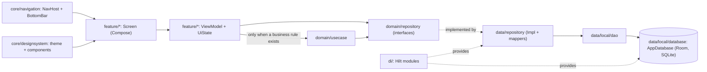

# Design Document

## Overview

This design implements the technical foundation described in `requirements.md`: a single-module, offline-first Android app with layered packages, Hilt, a Room database (one settings table), a centralized Navigation Compose host with a five-item bottom bar, a Material 3 design system, and a testing baseline. It contains no business functionality.

The design follows `.kiro/steering/tech.md` and `structure.md`. It was written after reading the current Gradle files, the version catalog and the three steering documents.

### Assumptions (user did not answer the open questions)

| # | Open question | Assumption used | Effect |
|---|---|---|---|
| A1 | C1: raise `minSdk` 24 to 26 | **Yes**, `minSdk = 26` | Matches `tech.md`. Room 2.8 (min 23) and Hilt 2.60 (min 23) are satisfied. |
| A2 | C8: one foundation entity | **Yes**, one `AppSettingEntity` | Room cannot compile a database with zero entities. The table is the V1 Settings table from `structure.md`, so it is not throwaway. |
| A3 | C12: Room test approach | **JVM tests with Robolectric** | Room tests run under `testDebugUnitTest`. No emulator is needed. Adds `robolectric` and `androidx.test:core`. Requirement 9.10 (instrumented Room tests) then does not apply, and `androidTest` keeps only `ExampleInstrumentedTest`. |
| A4 | Property-based testing library (no requirement names one) | **Kotest Property** (`kotest-property`), used standalone from JUnit 4 | Adds one test-only dependency. See "Library versions" for the compatibility risk. Without it, Correctness Properties cannot be implemented. |

### Research Summary (verified 2026-11, sources linked)

Versions in the unmodified project: AGP 9.5.1, Gradle 9.6.0, Kotlin 2.2.10, Compose BOM 2026.02.01 (Compose 1.10.4, Material 3 1.4.0).

Key findings that shape the design:

1. **AGP 9 has built-in Kotlin.** The `kotlin-android` plugin must not be applied, and `kapt` is incompatible. The current build already complies (it applies only `kotlin-compose`). KSP 2.3.1 or later is required for AGP 9, and KSP is no longer tied to the Kotlin compiler version since 2.3.0. ([Android Developers: built-in Kotlin](https://developer.android.com/build/migrate-to-built-in-kotlin), [Kotlin AGP 9 version matrix](https://github.com/kotlin/kotlin-agent-skills/blob/main/skills/kotlin-tooling-agp9-migration/references/VERSION-MATRIX.md))
2. **AGP 9 needs at least KGP 2.2.10 at runtime.** The project is exactly at that minimum, so Kotlin must not be lowered. (same matrix)
3. **The Hilt Gradle plugin requires AGP 9 from Dagger 2.59.** Dagger 2.59.1 sets the minimum AGP to 9.0.0. Dagger 2.59.2 fixes a slow incremental build issue, and 2.60.1 is the latest release. ([Dagger releases](https://github.com/google/dagger/releases))
4. **KSP 2.3.13 has a known regression** with concurrent executions (issue 3286). 2.3.14 is the latest and fixes it. ([KSP releases](https://github.com/google/ksp/releases))
5. **Room 2.8.5 is the latest 2.x stable.** Room 3.0.3 now exists under new `androidx.room3` coordinates. This design keeps Room 2.x because `tech.md` names Room and a 3.0 migration is out of scope. ([Room release notes](https://developer.android.com/jetpack/androidx/releases/room), [AndroidX versions](https://developer.android.com/jetpack/androidx/versions))
6. **Navigation 2.10.2 is in maintenance mode.** Navigation 3 (`navigation3` 1.2.2) exists. `tech.md` specifies Compose Navigation with type-safe routes, so this design keeps Navigation Compose 2.10.2. ([Navigation release notes](https://developer.android.com/jetpack/androidx/releases/navigation))
7. **Lifecycle 2.11.1 does not fit the Compose BOM.** I read its POM: `lifecycle-runtime-compose:2.11.1` depends on Compose runtime 1.11.0, while the BOM pins 1.10.4. Lifecycle 2.10.0 depends on Compose runtime 1.9.0 and fits. Navigation Compose 2.10.2 requires Compose 1.10.5, a patch-level bump over the BOM that Gradle resolves on its own.
8. **Newer kotlinx.serialization releases need a newer Kotlin.** 1.10.0 is based on Kotlin 2.3.0, 1.11.0 on 2.3.20, and 1.12.0 and 1.13.0 on 2.4.10. Version 1.9.0 is the last release built on Kotlin 2.2, so it is used. ([kotlinx.serialization changelog](https://github.com/Kotlin/kotlinx.serialization/blob/master/CHANGELOG.md))
9. **Robolectric 4.17 added Android SDK 37 support**, and 4.18.1 is the latest release. ([Robolectric releases](https://github.com/robolectric/robolectric/releases))
10. **The Navigation Compose default `NavHost` transition is a 700 ms fade.** This would breach Requirement 7.7 (300 ms) and come close to the 1 s limit in Requirement 12.4, so the design disables transitions between top-level destinations.

Content was rephrased for compliance with licensing restrictions.

### Library versions

| Alias group | Artifact(s) | Version | Status | Notes |
|---|---|---|---|---|
| AGP | `com.android.application` | 9.5.1 | existing | Unchanged (Req 1.5). |
| Kotlin | `kotlin-compose`, new `kotlin-serialization` plugin | 2.2.10 | existing | Both plugins use `version.ref = "kotlin"`. |
| Gradle | wrapper | 9.6.0 | existing | Unchanged. |
| KSP | `com.google.devtools.ksp` | **2.3.14** | new | Meets "2.3.1 or later for AGP 9". Avoids the 2.3.13 regression. |
| Hilt | `com.google.dagger:hilt-android`, `hilt-compiler` (KSP), `hilt-android-testing`, plugin `com.google.dagger.hilt.android` | **2.60.1** | new | Fallback if the compatibility check below fails: **2.59.2**. |
| Hilt Navigation Compose | `androidx.hilt:hilt-navigation-compose` | **1.4.0** | new | Provides `hiltViewModel()`. |
| Room | `room-runtime`, `room-ktx`, `room-compiler` (KSP), `room-testing` | **2.8.5** | new | `room-ktx` is still published for 2.8. Verify during implementation whether it is still needed, because coroutine support moved into `room-runtime`. If not needed, drop it (YAGNI). |
| Navigation | `androidx.navigation:navigation-compose` | **2.10.2** | new | Type-safe routes. |
| Lifecycle | `lifecycle-runtime-compose`, `lifecycle-viewmodel-compose` (new); `lifecycle-runtime-ktx` (existing) | **2.10.0** | new, raises existing 2.6.1 | One `lifecycle` version for all three. |
| Coroutines | `kotlinx-coroutines-android`, `kotlinx-coroutines-test` | **1.10.2** | new | 1.11.0 exists. Its Kotlin baseline was not verified, so the proven 1.10.2 is used. |
| Serialization | `org.jetbrains.kotlinx:kotlinx-serialization-core` | **1.9.0** | new | `@Serializable` routes need only the core artifact. The JSON artifact is not needed. |
| Robolectric | `org.robolectric:robolectric` | **4.18.1** | new, test only | Supports SDK 37. |
| AndroidX Test | `androidx.test:core` | **1.7.0** | new, test only | `ApplicationProvider` for Room tests. |
| Kotest | `io.kotest:kotest-property` | **5.9.1** | new, test only | 6.x exists, but its Kotlin baseline was not verified. 5.9.1 is the conservative choice. |
| Unchanged | Compose BOM `2026.02.01`, `core-ktx` 1.10.1, `activity-compose` 1.8.0, JUnit 4.13.2, `androidx.test.ext:junit` 1.1.5, Espresso 3.5.1 | n/a | existing | See the Requirement 1.7 note below. |

### Compatibility flags (need your attention)

| # | Flag | Severity | Handling |
|---|---|---|---|
| F1 | **No confirmed incompatibility with AGP 9.5.1 and Kotlin 2.2.10 was found.** Three combinations are unproven until the first build: Hilt 2.60.1 (built with Kotlin 2.3.21, so its Kotlin metadata is one minor version ahead of the 2.2.10 compiler), KSP 2.3.14 with built-in Kotlin, and Kotest 5.9.1 with Kotlin 2.2.10. | Medium | Increment 1 and 2 build gates (Requirement 12.7). If Hilt 2.60.1 fails, use 2.59.2 (the first release with AGP 9 support that predates the Kotlin 2.3 build). If any artifact still fails, Requirement 1.8 applies: stop, leave AGP and Kotlin unchanged, and report the artifact and version. |
| F2 | **Requirement 1.7 wording ("lowest released version") cannot be checked literally.** Transitive minimums are not all published as simple version numbers (for example Navigation 2.10.2 declares a mix of Compose and lifecycle requirements in Gradle module metadata). | Low | Design rule: raise an existing entry only when `./gradlew :app:dependencyInsight` shows Gradle resolving a higher version than declared. Set the catalog to that resolved version. `lifecycle` is set to 2.10.0 because it is the newest line that fits the BOM (finding 7), not because 2.10.0 is proven minimal. Suggest rewording Requirement 1.7 to "the version Gradle resolves". |
| F3 | **Requirement 9.2 conflicts with Requirements 4.8 and 10.2.** It asks for a ViewModel test that injects a test dispatcher through a qualified parameter, but a placeholder ViewModel has no asynchronous work. Adding a dispatcher parameter that nothing uses is an unused abstraction. | Medium | Placeholder ViewModels take no dispatcher. The ViewModel test uses `MainDispatcherRule` and asserts the initial `UiState`. The qualified-parameter injection is verified by the Hilt module replacement test (Requirement 4.11). Suggest rewording Requirement 9.2. |
| F4 | `SettingsRepository` has no consumer in app code, and `@DefaultDispatcher` and `@MainDispatcher` have no consumer. Requirement 10.2 forbids interfaces without a consumer. | Low | Accepted. Requirements 5.14 and 4.6 explicitly require them. Their consumers are the foundation tests and the first feature specs. |
| F5 | `Clock` needs a Hilt provider, but Requirement 4 lists only three modules. | Low | Add a fourth small module, `ClockModule`, in `di/`. `tech.md` allows "others as needed". See Components. |
| F6 | KSP with AGP 9 built-in Kotlin has had source-set issues in older KSP versions. | Low | KSP 2.3.14 is well past the 2.3.1 baseline. If the build reports a Kotlin source set error, report it rather than silently setting an AGP opt-out flag. |
| F7 | Room schema location through a KSP argument does not register the directory as a Gradle task input. | Low | Accepted for the foundation. The Room Gradle plugin is the fallback if `1.json` is not regenerated after deletion. |

## Architecture

### Layers and data flow



At foundation scope the ViewModels do not call any repository and no use case exists. The `UI → ViewModel → Repository → DAO → Database` chain is proven by the settings repository and its tests, not by a screen.

### Package layout (only packages that contain a file)

```text
com.example.sarisari.manager
|-- MainActivity.kt                         @AndroidEntryPoint, edge-to-edge, theme, SariSariApp()
|-- SariSariApplication.kt                  @HiltAndroidApp
|-- core
|   |-- designsystem
|   |   |-- Color.kt  Theme.kt  Type.kt     moved from ui/theme
|   |   `-- PlaceholderContent.kt           reusable composable (Req 6.7)
|   `-- navigation
|       |-- Routes.kt                       five @Serializable routes
|       |-- TopLevelDestination.kt          the one bottom-bar list (Req 7.3)
|       |-- SariSariApp.kt                  Scaffold + bottom bar + NavHost (root composable)
|       `-- SariSariNavHost.kt              the only NavHost (Req 7.1)
|-- data
|   |-- local
|   |   |-- database  AppDatabase.kt  Migrations.kt
|   |   |-- dao       AppSettingDao.kt
|   |   `-- entity    AppSettingEntity.kt
|   `-- repository    SettingsRepositoryImpl.kt  AppSettingMappers.kt
|-- domain
|   |-- model         AppSetting.kt
|   `-- repository    SettingsRepository.kt
|-- feature
|   |-- dashboard  DashboardScreen.kt  DashboardViewModel.kt  DashboardUiState.kt  DashboardNavigation.kt
|   |-- cashier    (same four files, Cashier prefix)
|   |-- products   (same four files)
|   |-- inventory  (same four files)
|   `-- reports    (same four files)
`-- di
    |-- Qualifiers.kt   DispatcherModule.kt  DatabaseModule.kt  RepositoryModule.kt  ClockModule.kt
```

`core/util` (named in Requirement 2.2) is **not created**, because no foundation file belongs there and Requirement 2.3 forbids empty packages. `domain/usecase` is also not created (Requirement 2.6: no use case without a business rule). Requirement 2.2 should be read as "these paths are allowed", and the structure steering file says to create folders when the first file arrives. This is a deliberate deviation, recorded here.

### Key design decisions

| # | Decision | Rationale |
|---|---|---|
| D1 | Persist settings with a `@Transaction` DAO method (read existing row, then `@Upsert`) instead of SQL `INSERT ... ON CONFLICT DO UPDATE`. | SQLite upsert syntax needs SQLite 3.24, which ships with API 30. `minSdk` is 26. The transaction preserves `createdAt` (Req 5.4) on every supported API level. |
| D2 | `DatabaseModule` passes the injected `@IoDispatcher` to `setQueryCoroutineContext`. | Satisfies Req 5.15 (queries off the main thread) and gives `@IoDispatcher` a real consumer. `allowMainThreadQueries` is never used. |
| D3 | `Migrations.kt` exposes `val ALL_MIGRATIONS: Array<Migration> = emptyArray()` and a constant for the database version. The builder uses `addMigrations(*ALL_MIGRATIONS)` and never calls any `fallbackToDestructiveMigration*` method. | Req 5.9 and 5.10. With no migration path Room throws `IllegalStateException` and leaves the file untouched (Req 5.11). |
| D4 | The `Clock` is `java.time.Clock` provided by `ClockModule` as `Clock.systemUTC()`. `SettingsRepositoryImpl` calls `clock.millis()`. | Gives tests deterministic timestamps with a hand-written fake `Clock` (Req 9.8) and stores UTC epoch milliseconds as `tech.md` requires. |
| D5 | Navigation uses `navigate(route) { popUpTo(Dashboard) { saveState = true }; launchSingleTop = true; restoreState = true }` and disables enter/exit transitions on the `NavHost`. | Gives Req 7.8, 7.9, 7.12 and a switch time well under 300 ms. Back from any non-Dashboard destination returns to Dashboard because Dashboard is always the bottom of the back stack. |
| D6 | Bottom-bar icons are five vector drawables in `res/drawable`. | Avoids the large `material-icons-extended` dependency. `material-icons-core` lacks suitable inventory and reports icons. |
| D7 | Placeholder `UiState` is `data class XxxUiState(@StringRes val titleRes: Int = R.string.destination_xxx)`. The bottom-bar item for the same destination uses the same string resource. | Requirement 8.2 (title text matches the bar label) holds by construction. Requirement 8.9 (initial value at creation) holds because the property has a default. |
| D8 | Each ViewModel exposes `val uiState: StateFlow<XxxUiState> = MutableStateFlow(XxxUiState()).asStateFlow()`. | One public `StateFlow` (Req 8.3). Nothing mutates it yet, so no scope or dispatcher is needed (see F3). |
| D9 | A JVM test, `SourceRulesTest`, scans `src/main` text for the structural rules that a compiler cannot check. | Gives Requirement 2.11 and 10.8 an automatic check with no new dependency. See Testing Strategy. |
| D10 | The Hilt Gradle plugin is applied, and `hilt-compiler` is added with `ksp` and `kspTest`. | Required for `@HiltAndroidApp`, and for the `@TestInstallIn` test. |

## Components and Interfaces

### Build configuration

`gradle/libs.versions.toml`: add the versions and aliases from the Library versions table. Bump `lifecycleRuntimeKtx` 2.6.1 to the `lifecycle` version (the key is renamed so the three lifecycle artifacts share it). Every library and plugin appears once (Req 1.9).

Root `build.gradle.kts`: add `alias(...) apply false` for `ksp`, `hilt`, and `kotlin-serialization`.

`app/build.gradle.kts` (shape, not final code):

- Plugins: `android-application`, `kotlin-compose`, `kotlin-serialization`, `ksp`, `hilt`. No `kotlin-android`, no `kapt` (Req 1.3).
- `defaultConfig.minSdk = 26`. `compileSdk`, `targetSdk`, Java 11 and the `release` optimization block are untouched (Req 1.5, 10.6).
- `ksp { arg("room.schemaLocation", "$projectDir/schemas") }` (Req 5.6, 5.8). The `app/schemas/` directory is committed and is not matched by any ignore rule (Req 5.7).
- `testOptions.unitTests.isIncludeAndroidResources = true` (needed by Robolectric).
- Dependencies, all through catalog aliases (Req 1.2): `implementation` for Hilt, Room, Navigation, Lifecycle, Coroutines, Serialization; `ksp` for `room-compiler` and `hilt-compiler`; `testImplementation` for JUnit, coroutines-test, Room testing, Robolectric, AndroidX Test core, Hilt testing, Kotest Property; `kspTest` for `hilt-compiler`. `androidTest` keeps its current dependencies. The existing `room-testing` requirement (Req 9.1) is met in `test` because the Room tests are JVM tests (A3). Req 9.1 also asks for it in `androidTest`, which the design omits because no instrumented Room test exists. This is part of the A3 effect.

`gradle.properties`: no change. Configuration cache stays enabled.

### Application and manifest

- `SariSariApplication : Application` with `@HiltAndroidApp` and no body.
- Manifest changes only: add `android:name=".SariSariApplication"` and set `android:allowBackup="false"`. The launcher intent filter, theme, label, icons, and no INTERNET permission remain untouched (Req 3.5, 1.10). `backup_rules.xml` and `data_extraction_rules.xml` are not edited.
- `MainActivity` keeps only `@AndroidEntryPoint`, `enableEdgeToEdge()`, `SariSariManagerTheme { SariSariApp() }`. `Greeting` and `GreetingPreview` are deleted (Req 8.7, 8.8).

### Dependency injection (`di/`)

```kotlin
// Qualifiers.kt
@Qualifier @Retention(BINARY) annotation class IoDispatcher
@Qualifier @Retention(BINARY) annotation class DefaultDispatcher
@Qualifier @Retention(BINARY) annotation class MainDispatcher

// DispatcherModule.kt   @Module @InstallIn(SingletonComponent::class)
@Provides @IoDispatcher      fun io(): CoroutineDispatcher = Dispatchers.IO
@Provides @DefaultDispatcher fun default(): CoroutineDispatcher = Dispatchers.Default
@Provides @MainDispatcher    fun main(): CoroutineDispatcher = Dispatchers.Main

// ClockModule.kt        @Module @InstallIn(SingletonComponent::class)
@Provides @Singleton fun clock(): Clock = Clock.systemUTC()

// DatabaseModule.kt     @Module @InstallIn(SingletonComponent::class)
@Provides @Singleton fun database(@ApplicationContext context: Context, @IoDispatcher io: CoroutineDispatcher): AppDatabase =
    Room.databaseBuilder(context, AppDatabase::class.java, DATABASE_NAME)
        .addMigrations(*ALL_MIGRATIONS)
        .setQueryCoroutineContext(io)
        .build()
@Provides fun appSettingDao(db: AppDatabase): AppSettingDao = db.appSettingDao()

// RepositoryModule.kt   @Module @InstallIn(SingletonComponent::class), abstract class
@Binds abstract fun settingsRepository(impl: SettingsRepositoryImpl): SettingsRepository
```

`Dispatchers.IO`, `Dispatchers.Default` and `Dispatchers.Main` appear only in `DispatcherModule` (Req 4.8). `RepositoryModule` has exactly one `@Binds`, because `SettingsRepository` is the only repository (Req 4.5, 4.9).

### Room (`data/local`)

```kotlin
@Entity(tableName = "app_settings")
data class AppSettingEntity(
    @PrimaryKey @ColumnInfo(name = "key") val key: String,
    @ColumnInfo(name = "value") val value: String,
    @ColumnInfo(name = "created_at") val createdAt: Long,
    @ColumnInfo(name = "updated_at") val updatedAt: Long,
)

@Dao
abstract class AppSettingDao {
    @Query("SELECT * FROM app_settings WHERE `key` = :key")
    abstract suspend fun getByKey(key: String): AppSettingEntity?

    @Query("SELECT * FROM app_settings WHERE `key` = :key")
    abstract fun observeByKey(key: String): Flow<AppSettingEntity?>

    @Upsert
    protected abstract suspend fun upsert(entity: AppSettingEntity)

    @Transaction
    open suspend fun write(key: String, value: String, nowMillis: Long) {
        val existing = getByKey(key)
        upsert(AppSettingEntity(key, value, existing?.createdAt ?: nowMillis, nowMillis))
    }
}

@Database(entities = [AppSettingEntity::class], version = AppDatabase.VERSION, exportSchema = true)
abstract class AppDatabase : RoomDatabase() {
    abstract fun appSettingDao(): AppSettingDao
    companion object { const val VERSION = 1 }
}
```

The column is named `key`, which is an SQL keyword. Generated SQL escapes it. Hand-written `@Query` text must quote it with backticks as shown.

Adding a future entity (Req 5.12): create entity and DAO, add them to `@Database`, raise `VERSION`, append a `Migration` to `ALL_MIGRATIONS`, add one `@Provides` DAO function. Nothing else in `DatabaseModule` changes.

### Domain and repository

```kotlin
// domain/model
data class AppSetting(val key: String, val value: String, val createdAt: Long, val updatedAt: Long)

// domain/repository  (no android, androidx, room or dagger imports)
interface SettingsRepository {
    suspend fun getSetting(key: String): AppSetting?
    fun observeSetting(key: String): Flow<AppSetting?>
    suspend fun putSetting(key: String, value: String)   // IllegalArgumentException if key or value is out of bounds
}

// data/repository
class SettingsRepositoryImpl @Inject constructor(dao: AppSettingDao, clock: Clock) : SettingsRepository
internal fun AppSettingEntity.toDomain(): AppSetting
internal fun AppSetting.toEntity(): AppSettingEntity
```

`putSetting` checks `key.length in 1..128` and `value.length <= 4096` before touching the database (Req 5.2), then calls `dao.write(key, value, clock.millis())`. Reads and observes return `null` for a missing key and never throw (Req 5.5). Room entities never appear in `domain/` (Req 2.7).

### Design system (`core/designsystem`)

- `Theme.kt`: `SariSariManagerTheme(darkTheme: Boolean = isSystemInDarkTheme(), dynamicColor: Boolean = false, content)`. Dynamic color applies only when the parameter is `true` and `Build.VERSION.SDK_INT >= 31` (Req 6.4, 6.5). Otherwise the light or dark brand scheme applies.
- `Color.kt`: one light and one dark scheme in a brand palette. None of the template values (`0xFF6650A4`, `0xFF625B71`, `0xFF7D5260`, `0xFFD0BCFF`, `0xFFCCC2DC`, `0xFFEFB8C8`) may remain (Req 6.3). The exact brand colors are chosen during implementation and need your approval.
- `Type.kt`: `bodyLarge`, `bodyMedium`, `bodySmall` all at `16.sp` with `24.sp` line height (Req 6.6). Material 3 defaults would give `bodySmall` 12 sp.
- `PlaceholderContent(title: String, modifier)`: a centered `Text` in `Box`. Every placeholder screen uses it (Req 6.7). It holds no interactive element. The bottom bar items use the Material 3 `NavigationBarItem`, whose touch target is above 48 dp (Req 6.8).
- `@Preview` for the theme and one `@Preview` per stateless placeholder composable (Req 6.11).
- All user-visible text lives in `strings.xml`: the existing `app_name` plus `destination_dashboard`, `destination_cashier`, `destination_products`, `destination_inventory`, `destination_reports` (Req 6.10).
- Edge-to-edge: `enableEdgeToEdge()` in `MainActivity`, and `Scaffold` passes `innerPadding` to the `NavHost` so content stays clear of the system bars. `NavigationBar` consumes the bottom inset itself (Req 6.9).

### Navigation (`core/navigation`)

```kotlin
// Routes.kt
@Serializable data object DashboardRoute
@Serializable data object CashierRoute
@Serializable data object ProductsRoute
@Serializable data object InventoryRoute
@Serializable data object ReportsRoute

// TopLevelDestination.kt  (the one list: route, label, icon)
data class TopLevelDestination(val route: Any, @StringRes val labelRes: Int, @DrawableRes val iconRes: Int)
val topLevelDestinations: List<TopLevelDestination> = listOf(Dashboard, Cashier, Products, Inventory, Reports)

// SariSariApp.kt
@Composable fun SariSariApp()   // rememberNavController; Scaffold(bottomBar = NavigationBar over topLevelDestinations)

// SariSariNavHost.kt
@Composable fun SariSariNavHost(navController, modifier)   // startDestination = DashboardRoute; calls the five feature builders
```

- An item is selected when `currentDestination?.hierarchy?.any { it.hasRoute(item.route::class) } == true`. Exactly one item matches at a time (Req 7.10).
- Tapping an item calls `navController.navigate(item.route) { popUpTo<DashboardRoute> { saveState = true }; launchSingleTop = true; restoreState = true }`.
- Each feature exposes `fun NavGraphBuilder.<name>Screen()` in its `<Name>Navigation.kt`, which registers `composable<XxxRoute> { XxxScreen() }`. `SariSariNavHost` only calls those five functions (Req 7.13). Feature packages import their route from `core/navigation`, and `core/navigation` imports the builder functions, so the two packages reference each other. This stays inside one module and matches `structure.md` section 7.
- `NavHost` sets `enterTransition = { EnterTransition.None }` and `exitTransition = { ExitTransition.None }` (and the pop variants), per D5.
- `rememberNavController()` saves the back stack across rotation and process recreation (Req 12.5).

### Feature packages (five, identical shape)

For `Xxx` in Dashboard, Cashier, Products, Inventory, Reports:

```kotlin
data class XxxUiState(@StringRes val titleRes: Int = R.string.destination_xxx)

@HiltViewModel
class XxxViewModel @Inject constructor() : ViewModel() {
    val uiState: StateFlow<XxxUiState> = MutableStateFlow(XxxUiState()).asStateFlow()
}

@Composable fun XxxScreen(viewModel: XxxViewModel = hiltViewModel()) {          // stateful
    val uiState by viewModel.uiState.collectAsStateWithLifecycle()
    XxxContent(uiState)
}
@Composable internal fun XxxContent(uiState: XxxUiState) =                        // stateless
    PlaceholderContent(title = stringResource(uiState.titleRes))
@Preview @Composable private fun XxxContentPreview() { SariSariManagerTheme { XxxContent(XxxUiState()) } }
```

Each package has exactly one `*Screen`, one `*ViewModel` and one `*UiState` (Req 2.8). No business data, input, or action appears (Req 8.6).

### Files the foundation touches

| Action | Files |
|---|---|
| Modify | `gradle/libs.versions.toml`, `build.gradle.kts`, `app/build.gradle.kts`, `AndroidManifest.xml`, `strings.xml`, `MainActivity.kt` |
| Move (smart relocate) | `ui/theme/Color.kt`, `Theme.kt`, `Type.kt` to `core/designsystem` (then edit them). `ui/theme` ends empty and is removed (Req 6.2). |
| Create | The files in the package layout above, five vector drawables `ic_nav_*.xml`, `app/schemas/.../1.json` (generated), `src/test/resources/robolectric.properties` |
| Create (tests) | See Testing Strategy |

## Data Models

### `app_settings` table (schema version 1)

| Column | SQL type | Null | Constraint | Domain rule |
|---|---|---|---|---|
| `key` | TEXT | no | PRIMARY KEY | 1 to 128 characters |
| `value` | TEXT | no | none | 0 to 4,096 characters (empty allowed) |
| `created_at` | INTEGER | no | none | UTC epoch milliseconds. Set on first write, never changed after. |
| `updated_at` | INTEGER | no | none | UTC epoch milliseconds. Set on every write. |

Room generates `app/schemas/com.example.sarisari.manager.data.local.database.AppDatabase/1.json` at compile time.

### Mapping

`AppSettingEntity` and `AppSetting` have identical fields. The mapper copies all four fields, so mapping in either direction loses nothing (Req 5.14). They remain separate classes because `structure.md` keeps Room entities out of the domain layer.

### Migration registry

`ALL_MIGRATIONS` is empty at version 1. Its contract for later versions: migrations sorted by start version, each end version equal to the next start version, first start version is 1, last end version equals `AppDatabase.VERSION`.

### Out of scope data

No Product, Category, Sale, SaleItem or StockMovement entity, DAO or table exists (Req 5.13).


## Correctness Properties

*A property is a characteristic or behavior that should hold true across all valid executions of a system-essentially, a formal statement about what the system should do. Properties serve as the bridge between human-readable specifications and machine-verifiable correctness guarantees.*

Automated property tests apply only to the settings data path (mapper, repository, DAO), which is the one place in the foundation with input-dependent logic. The rest of the foundation is build configuration, dependency wiring, navigation and placeholder UI. Those parts use smoke, example and manual checks (see Testing Strategy).

Reflection result: the criteria 5.3 and 9.4 test the same write-then-read behavior, so they share Property 2. Criteria 5.4 and 9.5 share Property 3. Criteria 5.14 and the mapping half of 2.7 share Property 1. Observing a setting through the `Flow` is covered inside Properties 2 and 4, so no separate observe property exists.

### Property 1: Entity and domain mapping round trip

*For any* `AppSetting` with any key, value, `createdAt` and `updatedAt`, converting it to an `AppSettingEntity` and back yields an equal `AppSetting`. *For any* `AppSettingEntity`, converting it to the domain model and back yields an equal entity.

**Validates: Requirements 5.14, 2.7**

### Property 2: Write then read round trip

*For any* valid key (1 to 128 characters) and valid value (0 to 4,096 characters), after `putSetting(key, value)`, both `getSetting(key)` and the first emission of `observeSetting(key)` return a setting whose key and value equal those written.

**Validates: Requirements 5.3, 9.4**

### Property 3: Overwrite keeps one row and preserves createdAt

*For any* valid key, any two values `v1` and `v2`, and any clock times `t1 < t2`, writing `v1` at `t1` and then `v2` at `t2` leaves exactly one row for that key. That row has value `v2`, `createdAt = t1` and `updatedAt = t2`. Rows for other keys are unchanged.

**Validates: Requirements 5.4, 9.5**

### Property 4: Absent key reads as null

*For any* key that has not been written, and any set of other keys already written, `getSetting(key)` returns `null`, the first emission of `observeSetting(key)` is `null`, and neither call throws.

**Validates: Requirements 5.5**

### Property 5: Out-of-bounds input is rejected without side effects

*For any* key that is empty or longer than 128 characters, or any value longer than 4,096 characters, `putSetting` throws `IllegalArgumentException` and the stored settings are unchanged. *For any* key and value inside the bounds, `putSetting` succeeds.

**Validates: Requirements 5.2**

## Error Handling

| Situation | Behavior | Requirement |
|---|---|---|
| Hilt graph cannot be built (missing binding, missing `@HiltAndroidApp`) | The build fails at compile time. If it occurs at runtime, the process crashes at launch with a report. No silent fallback. | 3.7, 4.10 |
| Library or plugin has no release compatible with AGP 9.5.1 and Kotlin 2.2.10 | Stop, leave AGP and Kotlin unchanged, report artifact and version (F1). | 1.8 |
| Database file version has no migration path | Room throws `IllegalStateException` from the first database call. The file is not deleted or changed. No `fallbackToDestructiveMigration*` call exists in any variant. | 5.10, 5.11 |
| `putSetting` called with an empty or oversized key, or an oversized value | `IllegalArgumentException` before any database access. This is a caller bug, not a user-facing error. Feature ViewModels that later write settings must validate or map it to a UI message. | 5.2 |
| Read or observe of a missing key | Returns `null` (or emits `null`). No exception. | 5.5 |
| Database used after it is closed | Room 2.8.5 throws `IllegalStateException` from suspending queries. Not handled. The database is a process-lifetime singleton. | n/a |
| Placeholder ViewModel has not emitted a state | Cannot happen. `StateFlow` holds the initial `UiState` at creation. | 8.9 |
| Tap on the selected bottom-bar item | `launchSingleTop` keeps the current entry and its state. No back stack entry is added. | 7.9 |
| Static rule violated (domain imports Android, `Dispatchers.*` outside `DispatcherModule`, destructive migration, INTERNET permission, empty package, `ui/theme` still present, and so on) | `SourceRulesTest` fails and its message names the file and the requirement number. | 2.11, 10.8 |
| A build gate fails after an increment | Fix and re-run before the next increment. | 12.6 |

## Testing Strategy

### Approach

All automated tests are JVM tests run by `./gradlew testDebugUnitTest` (A3). Property-based testing is used for Properties 1 to 5 only. The remaining criteria use example tests, static source checks, compilation, and a manual device check. Mocking frameworks are not used (Req 9.8). The only test double is a hand-written `FakeClock` (a `java.time.Clock` subclass with a settable time).

Why PBT does not apply elsewhere: dependency wiring, manifest values, navigation behavior and placeholder UI have no meaningful "for all inputs" statement. The only fixed inputs are five destinations and one empty migration list.

### Property-based tests

- Library: Kotest Property (`io.kotest:kotest-property`), called from JUnit 4 tests with `runBlocking { checkAll(iterations = 100, ...) }`. No property-testing framework is implemented by hand.
- Each property is one test with at least 100 iterations, and one `Arb` combination covering the whole domain, including edge values: empty value, 1-character and 128-character keys, 4,096-character values, Unicode and SQL-sensitive characters (`'`, `%`, `\u0000`, emoji).
- Each test carries a tag comment in this format: `// Feature: sarisari-project-foundation, Property N: <property text>`.
- Properties 2 to 5 run against a real in-memory `AppDatabase` under Robolectric and `SettingsRepositoryImpl` with `FakeClock`. The database is created once per test class and cleared between iterations with `clearAllTables()`, which keeps 100 iterations fast. Property 1 is a pure function test and needs no Robolectric.
- `robolectric.properties` pins the SDK to a version Robolectric supports (36, or 37 once confirmed stable on the first run).

| Test file (`src/test/java/.../`) | Covers |
|---|---|
| `data/repository/AppSettingMappersPropertyTest` | Property 1 |
| `data/repository/SettingsRepositoryPropertyTest` | Properties 2, 3, 4, 5 |

### Example and unit tests

| Test file | Covers |
|---|---|
| `testing/MainDispatcherRule` (helper) | Req 9.3. `TestWatcher` that calls `Dispatchers.setMain` before and `resetMain` in `finished`, so it also runs after a failing test. |
| `feature/PlaceholderViewModelsTest` | Req 8.9, 9.2. Under `MainDispatcherRule`, for each of the five ViewModels, `uiState.value` equals its default `UiState`, and the `titleRes` is the expected destination string. |
| `data/local/AppSettingDaoTest` | Req 9.4, 9.5. One concrete write-read and one concrete overwrite case. Readable examples next to the properties. |
| `data/local/database/MigrationsTest` | Req 9.6. `AppDatabase.VERSION == 1`, `ALL_MIGRATIONS` is empty, and the chain assertions are written for the general case (first start is 1, contiguous, last end equals `VERSION`). The source has no `fallbackToDestructiveMigration`. |
| `data/local/database/DatabaseOpenFailureTest` | Req 5.11. Create a version 1 file, reopen with a higher version and no migration, expect an exception, and assert the file bytes are unchanged. |
| `core/navigation/TopLevelDestinationsTest` | Req 7.4, 7.5, 9.7. Exactly five items, in the order Dashboard, Cashier, Products, Inventory, Reports, no duplicate route or label. |
| `core/designsystem/TypographyTest` | Req 6.6. `bodyLarge`, `bodyMedium`, `bodySmall` font sizes are at least 16 sp. |
| `di/DispatcherModuleReplacementTest` | Req 4.6, 4.11. Robolectric Hilt test with `@HiltAndroidTest`, `HiltTestApplication` and a `@TestInstallIn` module replacing `DispatcherModule`. A test-only holder class receives the `@IoDispatcher`, `@DefaultDispatcher` and `@MainDispatcher` parameters, and the test asserts it got the replacements with no duplicate-binding error. |
| `SourceRulesTest` | Static checks over `app/src/main` text, with failure messages that name the file and requirement. Rules: no empty package directory (2.3), `ui/theme` is absent (6.2), no `android.`, `androidx.` or `dagger.` imports in `domain/` (2.4), no `data.local` import in `feature/` or `core/` (2.9, 10.4), exactly one `NavHost(` call (7.1), no `Dispatchers.` outside `DispatcherModule` (4.8), no `fallbackToDestructiveMigration` or `allowMainThreadQueries` (5.10, 5.15), no `kapt` in Gradle files (1.3), no `INTERNET` in the manifest (1.10, 11.4), `allowBackup="false"` (3.4), no template purple hex values (6.3), no `Text("...")` string literal in Kotlin (6.10), no `Greeting` (8.8), and exactly one `*Screen`, `*ViewModel` and `*UiState` per feature (2.8). |

### Build gates and manual checks

| Check | When | Requirement |
|---|---|---|
| `./gradlew assembleDebug` exit 0, no new warnings | After every increment | 1.11, 1.12, 12.1, 12.6 |
| `./gradlew testDebugUnitTest` exit 0 | After increments 1 to 6 as tests appear | 9.9, 12.2 |
| `./gradlew :app:dependencyInsight` for lifecycle, activity and core | Increment 1 | F2, 1.7 |
| Confirm `app/schemas/.../1.json` exists and `git check-ignore app/schemas` reports nothing | After Room increment | 5.7, 5.8 |
| Launch on an API 26+ emulator, confirm Dashboard and the bottom bar within 5 s | End | 3.6, 12.3 |
| Tap each of five items, confirm screen within 1 s, one selected item, tap selected item (no change), back from non-Dashboard goes to Dashboard, back on Dashboard exits | End | 7.6 to 7.12, 12.4 |
| Rotate the device and kill-restore the process, confirm same destination and bar | End | 12.5 |
| Check edge-to-edge insets, 48 dp targets, and previews render in Android Studio | End | 6.8, 6.9, 6.11 |

`ExampleInstrumentedTest` stays in `androidTest` and is the only instrumented test (Req 9.11). Req 9.10 does not apply under assumption A3.

### Implementation order (Requirement 12.7)

1. Dependencies: catalog, plugins, `minSdk = 26`. Build gate. Run `dependencyInsight`.
2. Hilt and `SariSariApplication`, manifest, `DispatcherModule`, `ClockModule`, qualifiers. Build gate.
3. Room: entity, DAO, database, migrations, repository, mappers, `DatabaseModule`, `RepositoryModule`. Build gate. Check `1.json`.
4. Design system: move theme, new palette, typography, `PlaceholderContent`, strings.
5. Navigation and screens: routes, destination list, host, root composable, five feature packages, vector icons, trim `MainActivity`. Build gate.
6. Tests: the helper, property tests, example tests, `SourceRulesTest`, the Hilt test. Run `testDebugUnitTest`. Then the manual device check.

### Decisions that need your approval

1. The assumptions A1 to A4 at the top.
2. The brand color palette (chosen at the design system increment).
3. Hilt 2.60.1 with the 2.59.2 fallback, and the Kotest Property dependency (F1).
4. Rewording Requirements 1.7 and 9.2 (F2, F3), and reading Requirement 2.2 as "allowed paths", not "required empty folders".
5. The extra `ClockModule` (F5).
